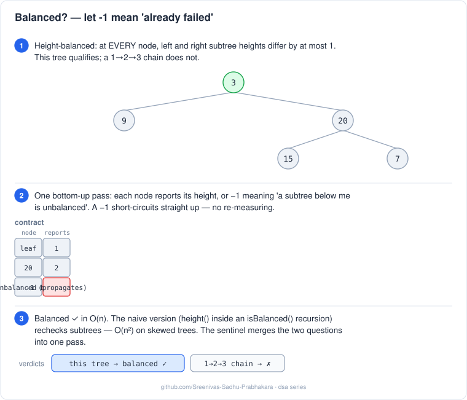

# Check if Height-Balanced

> Striver SDE Sheet 119 · Day 18 Binary Tree II — height with a poison value: -1 means "unbalance found below", and it propagates up without remeasuring. Go, stdlib only, tested.

## Problem

Is the tree height-balanced — every node's two subtree heights within one of each other? (The AVL property; note the root can look balanced while a subtree isn't, the case naive checks miss.)

## Approach

The O(n²) version calls Height at each node. The linear version weaponizes the height recursion's return value: it reports an honest height normally, but **-1 as a poison value** the instant any subtree is unbalanced — and every caller checks for the poison before doing arithmetic, so the verdict rides the normal return path to the root with no extra state and no second traversal. Encoding a failure flag inside an already-flowing value is a pattern worth keeping; Largest BST in a Tree (#144) does the same with richer state.

**Complexity:** O(n) time, O(h) recursion.

## Visual walkthrough

Read the picture top to bottom — each numbered frame is one moment of the algorithm
running on this repo's test example.

## Run

    go test ./...   # verify
    go run .        # demo

---

One of 191 repos solving Striver's SDE Sheet in Go — stdlib only, one problem per repo, every solution tested. Browse the set: [`dsa-*` repos](https://github.com/Sreenivas-Sadhu-Prabhakara?tab=repositories&q=dsa-&type=source).
